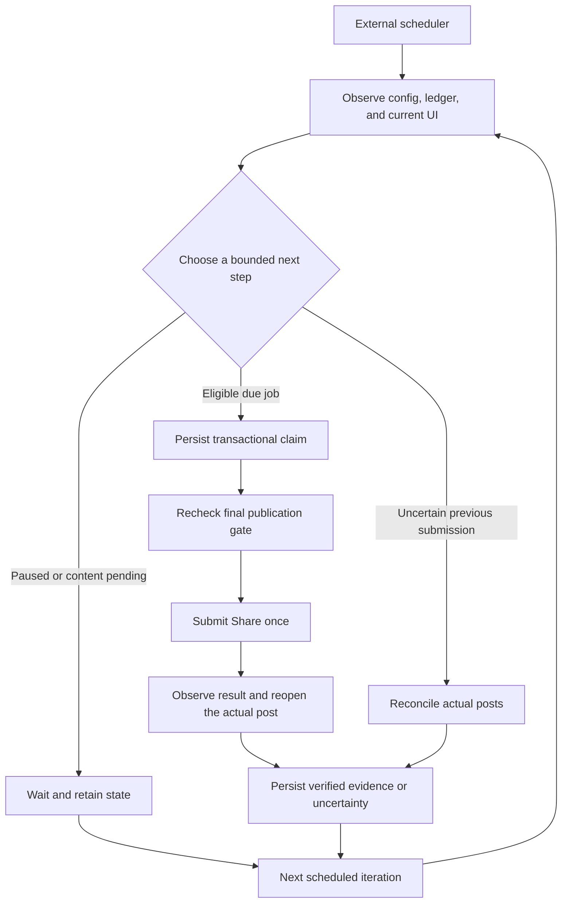

# Instagram Publishing Agent

[English](README.md) · [简体中文](README.zh-CN.md)

**Loop engineering for a stateful, verifiable Instagram publishing workflow.**

A local publication queue and operating protocol for a browser-capable agent,
organized around a persistent feedback loop:

**Observe → Decide → Claim → Act → Verify → Persist → Repeat.**

Each iteration reads durable state, makes a bounded decision, and records what
actually happened. The next iteration uses those records to determine whether
to publish, wait, stop, or reconcile an uncertain result.

**The Python program does not log in to Instagram, control a browser, generate
AI content, or run a scheduler by itself.** An authorized agent with browser tools
performs those steps using [the operating protocol](docs/OPERATIONS.md).
The original prototype used Codex Computer Use and a local scheduled chat.
No API keys or browser sessions are included in this repository.

## Loop engineering

In this repository, **loop engineering** means designing the control flow, state,
checks, feedback, and recovery rules around every agent action. A scheduled wake-up
starts one iteration; it does not by itself establish success.



| Loop stage | Implementation | Required outcome |
| --- | --- | --- |
| Observe | Local configuration, SQLite ledger, fresh browser state | Establish current facts before choosing an action. |
| Decide | `tick` and the surrounding agent | Produce a due job, a waiting state, or a reconciliation decision. |
| Claim | `claim`, inside a SQLite transaction | Persist the successful claim and publishing intent before submission. |
| Act | Authorized browser agent, after `check` | Submit the intended post once within the configured scope. |
| Verify | Platform result plus actual post readback | Check author, media, caption, and permalink. |
| Persist | `record` or `uncertain` | Make verified success or uncertainty available to the next run. |
| Repeat | External scheduler and persistent local files | Resume from durable evidence and current conditions. |

A useful iteration may publish nothing: paused work, missing brand content, or an
unknown submission result are explicit states. They must not cause filler posts
or blind retries.

The ledger and Instagram are separate systems. Transactional claims reduce
duplicate attempts, but **exactly-once publication is not guaranteed**. Evidence
flags are operator attestations; platform readback is the surrounding agent's
responsibility. Older unresolved jobs also require inspection across date changes.

Read [the loop engineering design](docs/LOOP_ENGINEERING.md) for the persisted
state machine, failure scenarios, recovery rules, and implementation boundaries.

## What is included

- A Python standard-library CLI backed by a persistent SQLite ledger.
- Account, local-date, media-integrity, pause, and daily-volume checks.
- A transactional claim so concurrent workers cannot claim the same post.
- A `VERIFY_REQUIRED` state for uncertain outcomes, without automatic resubmission.
- Publication records that require a canonical Instagram URL and explicit verification flags.
- Paused example configuration, post and evidence templates, and a disposable offline demo.
- A code-drawn image fixture rendered with an optional pinned `resvg-js` dependency.
- Automated tests and a GitHub Actions test workflow.

The validated publishing format is one PNG or JPEG Feed image per post.
This repository does not implement a Meta API adapter, cloud hosting, carousels,
Reels, Stories, professional Insights, or an unattended login mechanism.

## Quick start

Python 3.9+ and an available IANA timezone database are required for the ledger.
The tests run on Python 3.12 in CI. Node.js is only needed for the optional renderer.

After cloning this repository:

```sh
python3 -m unittest -v test_agent.py
python3 tools/demo.py
python3 agent.py init your_instagram_handle
python3 agent.py status
```

`init` creates an ignored local `config.json` with publishing **paused** and formal
content readiness **false**. It refuses to overwrite an existing configuration.
The offline demo uses a temporary account name and disposable local files. It makes
zero platform requests and never records a fake real-world publication.

## Prepare content

1. Edit local `config.json`: set your account, brand, language, IANA timezone, and content rules.
2. Supply actual reviewed brand content. Set `production_content_ready` to `true`
   only when the rules and assets are ready.
3. Copy `examples/post.example.json` to `inbox/today.json`.
4. Replace the account, caption, alt text, asset path, and `scheduled_at` value.
   The timestamp must include its UTC offset. Asset paths are relative to the manifest.
5. Mark the manifest `ready: true` after review. The supplied example is deliberately ineligible.
6. Resume publication eligibility when you intend to publish:

```sh
python3 agent.py resume
python3 agent.py tick
```

`tick` selects one eligible production job for the current local date. It does not
contact Instagram. A late job from a previous day cannot be claimed automatically.
The current daily workflow processes at most one post per account per day.

## Publish with an agent

When `tick` returns `due_production_job`, use the returned ID:

```sh
python3 agent.py claim POST_ID
```

The claim persists `PUBLISHING` before the agent submits anything. The browser agent
must verify the signed-in account, upload the specified image, retain its original
aspect ratio, enter the caption and alt text, and inspect the final preview.

Immediately before the final Share action:

```sh
python3 agent.py check POST_ID
```

After a successful check, submit **once**. Observe the platform's result, reopen the
actual post, and verify its author, image, caption, and permalink. Save the real
evidence locally using `examples/evidence.example.json` as a template:

```sh
python3 agent.py record POST_ID evidence/result.json
```

The verification flags are operator attestations. The CLI validates their shape;
it does not independently query Instagram or prove the contents of a screenshot.
The operator must actually perform and verify the external action.

If the result is uncertain:

```sh
python3 agent.py uncertain POST_ID
```

Reconcile actual Instagram posts before considering any retry. The CLI does not
provide a blind reset from `VERIFY_REQUIRED` to `READY`.

## Scheduling

Use a scheduler in an agent environment that has authorized browser tools.
[An example daily prompt](docs/AUTOMATION_PROMPT.md) describes the complete loop.
Creating a schedule is a separate step; this repository does not provision one.

A local scheduled chat needs its host computer and application to remain available.
Scheduled delivery may be delayed. A registered schedule is not evidence that a run
occurred, and an invoked run is not evidence that a post was published.

Run only `tick` from ordinary cron if you want queue preparation. That command alone
will **not** publish a post. A production browser executor or an official API adapter
must be integrated separately.

## Controls and state

```sh
python3 agent.py pause
python3 agent.py resume
python3 agent.py status
python3 agent.py dry-run
```

State lives in ignored `state/ledger.sqlite3`. Keep it across runs: deleting it removes
publication and deduplication history. The pause check applies to future agent actions;
it cannot undo a Share action that has already been submitted.

`dry-run` reads or initializes the local ledger without any browser or publication action.
`tick` may enqueue eligible manifests but does not publish them.

Private configuration, evidence, media, sessions, logs, and publication state should
remain local. They are excluded by the repository's `.gitignore`.

## Optional demonstration image

```sh
npm ci --ignore-scripts
npm run render-example
```

This creates `media/example.svg` and `media/example.png` at 1080 × 1350. The image is
clearly labeled as a demonstration asset. Replace it with your actual brand material.
No restaurant photograph or third-party brand asset is bundled.

## Verification

```sh
python3 -m unittest -v test_agent.py
python3 tools/demo.py
```

The tests cover transactional claims, duplicate prevention, pausing, changed media,
daily limits, future and expired jobs, content approval, uncertain outcomes, and receipt
validation. They do not post to Instagram. Platform validation requires the browser
procedure and real evidence described above.

## References and licensing

See [third-party notices](THIRD_PARTY_NOTICES.md) for the renderer dependency,
the researched Postiz reference, and official platform documentation.
No project license has been selected. Dependencies retain their own licenses.
